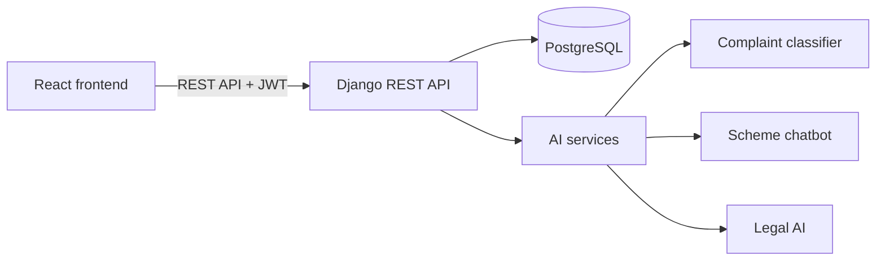
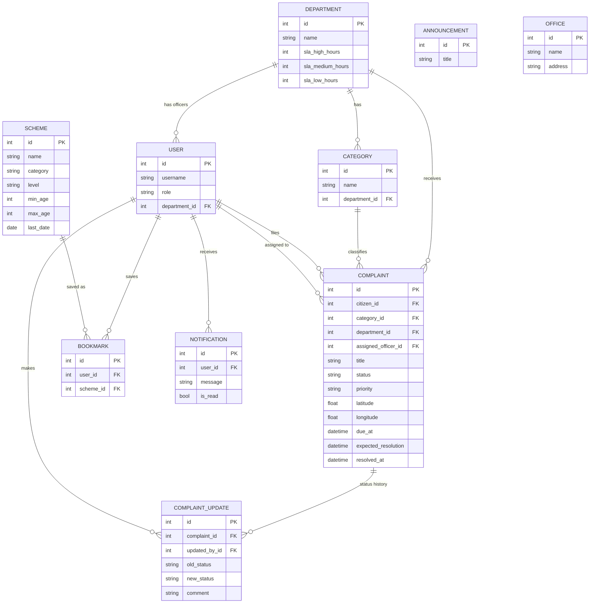

# Nagrik AI - Smart Citizen Services Portal

A single web platform where citizens can report civic problems, track their resolution, discover government schemes and get AI-assisted guidance, instead of visiting many separate departments and portals. Built for Uttarakhand.

## Problem

Citizens often do not know which department to approach, cannot easily track a complaint, and find it hard to know which government schemes they qualify for. Nagrik AI brings these services into one place.

## Features

**Citizen**
- File complaints with description, photo and GPS location
- Department is detected automatically (PWD, Nagar Palika, Water, Electricity, Traffic Police, Forest)
- Track status with a full timeline and expected resolution time
- Search government schemes (central + Uttarakhand), filter by category
- Eligibility checker based on age, income, occupation and gender
- Save schemes, get notifications, see announcements and nearby offices
- Scheme assistant chatbot and Legal AI page

**Department officer**
- Sees only the complaints of their own department
- Acknowledge, update status, set expected resolution time and add comments

**Admin (monitoring)**
- Overview of all complaints and department-wise performance
- Overdue complaints (SLA based on priority) and complaints not acknowledged for 4+ hours
- Can manage complaints of any department

## Tech stack

| Layer | Technology |
|---|---|
| Frontend | React (Vite), React Router, Axios |
| Backend | Django, Django REST Framework |
| Database | PostgreSQL |
| Auth | JWT (SimpleJWT), role based access (citizen / officer / admin) |
| AI modules | Complaint classifier, scheme chatbot, Legal AI (see status below) |

## Architecture



## Database design



## AI module status

| Module | Status |
|---|---|
| Complaint classifier (department + priority) | Keyword-based placeholder, ready to be replaced by the trained model |
| Scheme chatbot | Rule-based placeholder using the schemes database, ready for RAG / LLM integration |
| Legal AI (similar cases, provisions, outcome analysis) | Endpoint and UI ready, model not connected yet. It returns a clear "model not connected" message and a disclaimer |

The integration points are `backend/complaints/ai_service.py`, `backend/chatbot/services.py` and `backend/legal_ai/services.py`.

Legal AI will give general information only, cite sources and advise consulting a qualified lawyer. It will never tell a user to drop a case.

## Setup

Requirements: Python 3.13, Node.js, PostgreSQL.

**1. Database**

Create an empty PostgreSQL database named `nagrik_ai`.

**2. Backend**

```bash
cd backend
python -m venv venv
venv\Scripts\activate
pip install -r requirements.txt
```

Copy `.env.example` to `.env` and put your PostgreSQL password in it. Then:

```bash
python manage.py migrate
python manage.py seed_data
python manage.py seed_schemes
python manage.py createsuperuser
python manage.py runserver
```

The API runs at `http://127.0.0.1:8000`, the Django admin at `/admin/`.

**3. Frontend**

```bash
cd frontend
npm install
npm run dev
```

The app runs at `http://localhost:5173`.

## Demo accounts (development only)

`seed_data` creates demo users: `citizen1` and one officer per department (`officer_pwd`, `officer_nagar`, `officer_water`, `officer_electricity`, `officer_traffic`, `officer_forest`). Passwords are set in `backend/departments/management/commands/seed_data.py`. The admin account is the superuser you create. Change or remove these before any real deployment.

## API overview

| Endpoint | Purpose |
|---|---|
| `POST /api/auth/login/`, `POST /api/auth/register/`, `GET /api/auth/me/` | Authentication |
| `GET/POST /api/complaints/`, `GET /api/complaints/<id>/` | Complaints (filtered by role) |
| `POST /api/complaints/<id>/status/` | Officer / admin status update |
| `GET /api/admin/overview/` | Admin monitoring data |
| `GET /api/schemes/`, `POST /api/schemes/check/` | Schemes search and eligibility |
| `GET /api/schemes/bookmarks/`, `POST /api/schemes/<id>/bookmark/` | Saved schemes |
| `GET /api/notifications/`, `GET /api/announcements/`, `GET /api/offices/` | Dashboard data |
| `POST /api/chatbot/ask/`, `POST /api/legal/analyze/` | AI assistant endpoints |

## Disclaimer

Scheme information is for guidance only. Please confirm eligibility, dates and documents on the official website of each scheme. Legal AI output is general information, not legal advice.